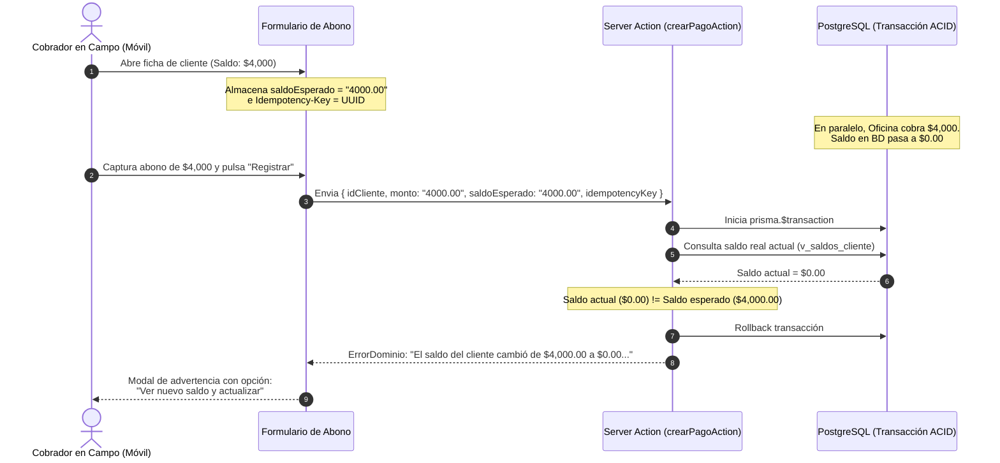

# ADR-11 — Control de Concurrencia, Prevención de Colisiones en Abonos Simultáneos y Estrategia de Comunicación en Tiempo Real

## 1. Metadatos

- **Identificador:** ADR-11 (Resolución de análisis técnico P18 en `roadmap`; referenciado como ADR-18 en `docs/DECISIONES.md`).
- **Título:** Control de concurrencia optimista (OCC), idempotencia y estrategia de comunicación servidor-web para prevención de colisiones en cobranza en campo y oficina.
- **Estado:** Propuesto (Aprobado para diseño arquitectónico; pendiente de implementación en fase técnica correspondiente).
- **Fecha:** 2026-10-14.
- **Autor / Rol:** Especialista en Arquitectura de Software y Documentación Técnica.
- **Alcance:** `src/server/services/pagos.ts`, `src/server/actions/pagos.ts`, `src/components/captura-abonos.tsx`, base de datos PostgreSQL, runtime de Node.js.

---

## 2. Contexto del Problema y Escenarios de Carrera en Tienda Pagos

### 2.1. Modelo operativo y financiero del negocio
Tienda Pagos opera un modelo de crédito personal en el que los clientes adquieren artículos de joyería y novedades a plazos flexibles sin intereses ni tablas de amortización prefijadas (`docs/DOMINIO.md`). El cliente mantiene una cuenta corriente acumulada (*running balance*), cuyo saldo se calcula de forma unificada mediante la fórmula de la regla 3 (`v_saldos_cliente` / `src/server/services/saldo.ts`):

$$\text{saldo}(\text{cliente}) = \sum \text{ventas.monto\_total} - \sum \text{pagos.monto} - \sum \text{devoluciones.monto\_credito} - \sum \text{ventas.enganche}$$

La operación de cobranza es intrínsecamente descentralizada y asíncrona:
1. **Cobradores en campo (rutas en calle):** Operan desde teléfonos inteligentes conectados a redes celulares móviles comerciales (3G, 4G, LTE), con frecuencia en áreas con cobertura intermitente, cambio de celdas celulares, fluctuaciones de latencia y pérdida ocasional de paquetes.
2. **Personal de mostrador y administración en oficina:** Operan desde estaciones de trabajo de escritorio o portátiles conectadas a redes de banda ancha estables (fibra óptica/WiFi), recibiendo pagos directos de clientes en tienda física o acreditando transferencias bancarias.

### 2.2. Escenarios críticos de colisión y condición de carrera (*Race Conditions*)

#### Escenario 1: Cobro simultáneo sobre saldo desactualizado (*Stale Read Race*)
- **Secuencia:**
  1. A las 10:00 AM, el cobrador en campo abre la ficha de la clienta "María López" en su teléfono móvil. La aplicación consulta el servidor y muestra un saldo adeudado de **$3,000.00 MXN**.
  2. A las 10:15 AM, la clienta realiza una transferencia bancaria a la cuenta de la empresa y llama a la oficina. El administrador registra de inmediato un abono de **$3,000.00 MXN** en la aplicación web de escritorio. En base de datos, el saldo real de la clienta pasa a ser **$0.00 MXN**.
  3. A las 10:20 AM, el cobrador en campo llega al domicilio de la clienta. Su pantalla en el navegador móvil sigue mostrando un saldo de **$3,000.00 MXN**, ya que la página no se ha recargado.
  4. El cobrador solicita el abono de $3,000.00 MXN. Si el cónyuge o familiar de la clienta atiende y paga en efectivo sin saber de la transferencia previa, el cobrador ingresa el pago de $3,000.00 MXN y presiona "Registrar".
  5. El servidor recibe la petición e inserta un nuevo registro en la tabla `pagos`.
- **Impacto de negocio:** El saldo de la clienta se vuelve negativo (**-$3,000.00 MXN**, saldo a favor indebido). Se genera un grave conflicto comercial, pérdida de confianza en la formalidad de la empresa, reclamos por cobro indebido y la necesidad de una aclaración y conciliación manual contable de devolución de efectivo.

#### Escenario 2: Reintentos ciegos por degradación o caída de red móvil (*3G/4G Flapping*)
- **Secuencia:**
  1. El cobrador registra un abono de **$500.00 MXN** en una zona con mala recepción de señal celular y pulsa el botón "Registrar".
  2. El paquete HTTP POST (Server Action) alcanza con éxito el servidor de la aplicación. La transacción de Prisma se ejecuta en PostgreSQL, insertando la fila en `pagos` y su auditoría en `auditoria`.
  3. Justo en ese instante, el dispositivo móvil cambia de celda de telefonía o pierde momentáneamente la conexión de subida/bajada. El paquete de respuesta HTTP 200/Redirect nunca regresa al navegador del teléfono antes del timeout del cliente.
  4. En la pantalla del teléfono, la interfaz muestra un error de red genérico o el botón de envío se desbloquea tras el timeout sin cambiar de pantalla.
  5. El cobrador, creyendo que el pago no se registró, presiona "Registrar" por segunda vez.
- **Impacto de negocio:** Se crean **dos abonos de $500.00 MXN** para el mismo cliente con segundos de diferencia. El saldo queda alterado artificialmente en la base de datos sin que ninguno de los dos actores haya cometido un error conceptual intencionado.

#### Escenario 3: Captura rápida en lote concurrente al cierre de jornada
- **Secuencia:**
  1. Al final del día, dos personas (ej. dos cobradores o un cobrador y un asistente de caja) capturan tandas de recibos acumulados en la pantalla `CapturaAbonos` (`src/components/captura-abonos.tsx`).
  2. Ambos operadores incluyen cobros del mismo cliente o procesan cobros sobre clientes cuyo saldo dependía de cancelaciones o ventas registradas minutos antes.
  3. La función `revisarDuplicadosAction` en el componente actual únicamente realiza una lectura previa informativa al armar el lote; no existe un cerrojo transaccional ni una validación de congruencia de estado en el momento en que se ejecuta `crearPagosEnLoteAction`.
- **Impacto de negocio:** Inconsistencias temporales en el cálculo del saldo proyectado y riesgo de inserción cruzada de cobros en libretas manuales.

### 2.3. Estado del código actual (inspección técnica)
- **Base de datos (`prisma/schema.prisma`):**
  - La tabla `pagos` no dispone de una columna `version`, ni `idempotency_key`, ni restricción de unicidad compuesta con ventana de tiempo.
  - La tabla `clientes` almacena datos demográficos, pero no mantiene un campo `updated_at` indexado o un token de versión que cambie cuando sus transacciones asociadas son alteradas.
- **Servicios (`src/server/services/pagos.ts`):**
  - La función `crearPago` ejecuta un bloque `prisma.$transaction`, pero dentro de él únicamente hace `tx.pago.create` y `registrarAuditoria`. No verifica el saldo previo ni si el cliente ha sufrido mutaciones concurrentes.
  - La función `buscarPagosDuplicados` y la clave `claveDuplicado` (`${idCliente}|${fecha}|${monto}`) están diseñadas deliberadamente como un aviso de advertencia visual no bloqueante en la interfaz de usuario, respetando la regla de negocio de que un cliente legítimamente puede realizar dos abonos iguales el mismo día. Sin embargo, no existe protección contra colisiones no intencionadas ni dobles envíos inmediatos (< 5 minutos).

---

## 3. Evaluación Comparativa de Tecnologías de Comunicación y Concurrencia

Se analizaron formalmente cuatro alternativas técnicas para abordar este problema en la arquitectura monolítica Next.js 15 / PostgreSQL de Tienda Pagos:

### 3.1. Alternativa A: WebSockets dedicados en Node.js / Railway

#### Descripción técnica
Configurar un servidor de WebSockets (usando la biblioteca `ws` o `Socket.io`) montado sobre el servidor Node.js en Railway (runtime standalone de Next.js), manteniendo conexiones TCP bidireccionales y persistentes con cada cliente conectado (móvil y desktop).

#### Análisis de viabilidad y riesgos
1. **Sobrecarga de red y ciclo de vida en redes celulares (3G/4G):**
   - En dispositivos móviles en movimiento, el cambio entre celdas telefónicas, cambios dinámicos de dirección IP pública del operador (Carrier-Grade NAT) y las políticas agresivas de ahorro de batería de los sistemas operativos (Android e iOS suspenden sockets en pestañas secundarias o pantallas bloqueadas) provocan caídas constantes de conexión (*connection flapping*).
   - Para mantener el socket activo se requiere una frecuencia alta de mensajes *heartbeat* (`ping/pong` cada 15 a 30 segundos), lo cual drena la batería del dispositivo y consume datos móviles innecesariamente.
   - Cada reconexión obliga a implementar una lógica compleja de renegociación, ráfagas de reconexión (*reconnection storms*) y búferes de mensajes perdidos en memoria.
2. **Infraestructura de Railway y escalabilidad:**
   - En Railway, el contenedor de Next.js corre bajo una sola instancia con límites establecidos de memoria y CPU. En despliegues continuos (*zero-downtime rolling deploys*) o reinicios por healthcheck, todas las conexiones TCP se cortan abruptamente, exigiendo sincronización de estado externo (ej. Redis Pub/Sub).
3. **Falacia del tiempo real como garantía transaccional:**
   - Disponer de un WebSocket no previene la condición de carrera en la base de datos: si dos usuarios tienen la aplicación abierta y pulsan "Abonar" con una diferencia de milisegundos, o si un cobrador estuvo desconectado 20 segundos antes de enviar el formulario, el WebSocket no evita la colisión. **La integridad transaccional debe resolverse forzosamente en el servidor.**
4. **Evaluación frente a la Regla 9 de `AGENTS.md`:**
   - Introducir una arquitectura de WebSockets dedicados con broker pub/sub para una plantilla de 3 a 6 usuarios concurrentes constituye una abstracción especulativa desmedida con un costo de mantenimiento injustificado.

### 3.2. Alternativa B: Supabase Realtime (Postgres Changes / CDC)

#### Descripción técnica
Utilizar el motor de Supabase Realtime, el cual escucha los eventos de replicación lógica de PostgreSQL (*Change Data Capture* o CDC vía `wal2json` / `pgoutput`) y emite notificaciones WebSocket directamente hacia los navegadores mediante el SDK cliente `@supabase/supabase-js`.

#### Análisis de viabilidad y riesgos
1. **Violación de fronteras arquitectónicas y ADR-15 (Autenticación propia):**
   - El proyecto estableció en el ADR-15 el uso de sesiones opacas propias en la base de datos (`model Sesion` con cookies `httpOnly`), rechazando expresamente Auth.js y Supabase Auth.
   - Conectar el cliente web directamente al WebSocket de Supabase requeriría o bien configurar claves públicas con *Row Level Security* (RLS) en PostgreSQL —desviándose de la arquitectura actual donde Prisma en el backend es el único autorizado para hablar con la base de datos—, o bien generar tokens JWT firmados para cada sesión del cliente, acoplando innecesariamente el frontend con el proveedor de infraestructura.
2. **Problema del cálculo del saldo (Regla 3 de `AGENTS.md`):**
   - Supabase Realtime notifica la inserción de una fila en la tabla `pagos` (ej. `{ id: 104, monto: 500, id_cliente: 12 }`).
   - Sin embargo, la interfaz de usuario no necesita únicamente saber que hubo un pago nuevo; necesita conocer el **saldo resultante actualizado**. Según la Regla 3, el saldo solo se calcula en `src/server/services/saldo.ts` o mediante la vista `v_saldos_cliente`.
   - Por tanto, al recibir el evento de Supabase Realtime, el cliente de todos modos se vería forzado a realizar una petición HTTP secundaria al servidor de Next.js para consultar el saldo real, anulando la ventaja del CDC directo.
3. **Consumo de conexiones y costos:**
   - Mantener canales abiertos de Realtime en Supabase computa contra la cuota de conexiones concurrentes del proyecto en el plan de Supabase, sin aportar un beneficio superior al del ciclo de vida natural de una Server Action.

### 3.3. Alternativa C: Server-Sent Events (SSE) y Polling Inteligente Condicional (SWR / ETag / Revalidate-on-Focus)

#### Descripción técnica
1. **Server-Sent Events (SSE):** Flujo unidireccional HTTP (`text/event-stream`) expuesto desde un Route Handler de Next.js (`/api/actividad/stream`), donde el servidor notifica a los clientes interesados cuando un movimiento es registrado.
2. **Polling Inteligente Condicional:** Consultas HTTP estándar periódicas o reactivas al contexto (mediante SWR o TanStack Query), que se disparan prioritariamente al recuperar el foco de la pantalla (`window.onfocus` / `visibilitychange`) o al volver a conectarse a internet (`window.ononline`). Emplea cabeceras de validación `If-None-Match` (ETags) o marcas de tiempo para recibir respuestas `304 Not Modified` de 0 bytes de carga útil si no han ocurrido cambios.

#### Análisis de viabilidad y fortalezas
1. **Naturaleza amigable con redes móviles:**
   - Las peticiones HTTP estándar atraviesan proxies, balanceadores de carga y redes de telefonía sin riesgo de bloqueo de puertos ni caídas de tunnels TCP.
2. **Patrón `revalidateOnFocus`:**
   - Se adapta de manera óptima al comportamiento real del cobrador en campo: el cobrador guarda el teléfono en el bolsillo entre cliente y cliente. Al llegar al destino y encender la pantalla, el evento `onfocus` dispara una verificación instantánea y ligera (< 100 ms). Si en la oficina se registró un pago mientras él se trasladaba, la interfaz actualiza el saldo de manera transparente antes de que el cobrador inicie la captura.
3. **Eficiencia en recursos y batería:**
   - Cuando la pantalla está apagada o la aplicación está en segundo plano, no hay tráfico de red ni consumo de batería.

### 3.4. Alternativa D: Control de Concurrencia Optimista (OCC) en Servidor + Ventana de Deduplicación

#### Descripción técnica
1. **Control de Concurrencia Optimista (OCC):**
   - En lugar de confiar en que la pantalla del cliente está al día, el servidor asume que el cliente puede estar trabajando con datos obsoletos y **valida atómicamente el estado previo en el momento de la mutación**.
   - El cliente envía junto al formulario de pago el `saldoEsperado` (o un `versionToken` / hash del estado del cliente) que estaba visualizando al iniciar la captura.
   - Dentro de la transacción en `src/server/services/pagos.ts`, el servicio consulta el saldo real actual (o la versión del cliente) bajo aislamiento transaccional.
   - Si el saldo actual difiere del `saldoEsperado`, la transacción se rechaza de inmediato con un `ErrorDominio`:
     > *"El saldo de este cliente cambió recientemente (saldo actual: $X.XX). Otro usuario registró un movimiento mientras tenías el formulario abierto. Por favor actualiza los datos antes de registrar el cobro."*
2. **Ventana de Deduplicación Temporal (Detección de cobro redundante):**
   - Dentro de la transacción de guardado, el servidor verifica si en una ventana temporal de cortesía de $N$ minutos (ej. últimos 5 minutos) ya se registró un pago para ese mismo `idCliente` con el mismo `monto`.
   - Si se detecta una coincidencia y el operador no activó una casilla explícita de confirmación (`confirmarDuplicadoIntencional: true`), el sistema bloquea el guardado preventivamente con una advertencia explicativa.
3. **Clave de Idempotencia (`Idempotency-Key`):**
   - Cada formulario genera al inicializarse un identificador único universal (UUID v4).
   - Si la red móvil titubea y el usuario hace doble clic o el navegador reintenta el envío HTTP tras un timeout de socket, el servidor reconoce la misma clave de idempotencia procesada en los últimos 60 segundos y responde exitosamente con el registro original sin duplicar la inserción en la base de datos.

---

## 4. Matriz Comparativa de Soluciones

| Criterio de Evaluación | A) WebSockets en Railway | B) Supabase Realtime | C) Polling / Revalidate-on-Focus | D) OCC + Deduplicación en Servidor |
|---|:---:|:---:|:---:|:---:|
| **Garantía absoluta contra colisiones financieras** | ❌ No (no previene carreras en BD) | ❌ No (solo es notificación) | ❌ No (solo minimiza desfase) | ✅ **Sí (bloqueo atómico transaccional)** |
| **Resiliencia ante redes móviles inestables (3G/4G)** | ❌ Muy baja (desconexiones continuas) | ⚠️ Media (depende del SDK móvil) | ✅ **Muy alta (HTTP sin estado)** | ✅ **Total (independiente de la red)** |
| **Protección contra doble clic / reintentos de red** | ❌ Nula | ❌ Nula | ❌ Nula | ✅ **Total (con Idempotencia)** |
| **Consumo de batería en teléfonos de cobradores** | ❌ Alto (heartbeats continuos) | ⚠️ Moderado | ✅ **Bajo (inactivo con pantalla apagada)** | ✅ **Cero impacto continuo** |
| **Complejidad de infraestructura y mantenimiento** | ❌ Muy alta (Redis, sockets en Node) | ⚠️ Alta (RLS, JWT, auth híbrido) | ✅ **Baja (HTTP estándar)** | ✅ **Mínima (dentro de Prisma exist)** |
| **Cumplimiento Regla 9 (Sin abstracciones especulativas)** | ❌ Falla (sobreingeniería) | ❌ Falla (acoplamiento externo) | ✅ Cumple | ✅ **Cumple estrictamente** |

---

## 5. Decisión Recomendada Fundamentada

### 5.1. Decisión principal
Se decide adoptar como arquitectura canónica la combinación de **Control de Concurrencia Optimista (OCC) en Server Actions con Claves de Idempotencia y Ventana de Deduplicación Temporal**, complementada en la capa de interfaz de usuario con **Revalidación al Enfoque (`revalidateOnFocus`)**.

Se **descarta formalmente el uso de WebSockets persistentes** en el contenedor Node.js de Railway y el uso de **Supabase Realtime en el cliente**.

### 5.2. Fundamentación de la decisión
1. **La integridad financiera es responsabilidad del servidor, no de la red:**
   Ningún protocolo de transporte en tiempo real (por rápido o sofisticado que sea) puede garantizar que dos solicitudes enviadas casi al unísono no colisionen si el motor transaccional de base de datos no las valida. Tratar de resolver la concurrencia en la capa de transporte (WebSockets) es un error conceptual; la única solución formalmente correcta y matemáticamente segura reside en la transacción ACID de la base de datos mediante OCC.
2. **Robustez ante el perfil de usuario real (Cobradores en campo):**
   El cobrador o vendedor de la tienda no está sentado frente a una pantalla con WiFi permanente viendo actualizarse un gráfico de cotizaciones. Está en la calle, entra a locales con mala señal, sube y baja de vehículos, y bloquea el teléfono constantemente. La solución debe ser tolerante al peor escenario de conectividad: desconexiones completas, pérdida de paquetes y latencias superiores a 5,000 ms. El esquema OCC + Idempotencia garantiza que jamás se generará un abono duplicado ni se sobreescribirá un saldo por error de red.
3. **Respeto a las reglas de arquitectura del repositorio:**
   - **Regla 1 (Dinero):** La verificación del saldo esperado opera con `Decimal` en el servidor y strings en la frontera.
   - **Regla 3 (Saldo único):** La verificación transaccional en el servidor reutiliza directamente `obtenerSaldo` de `src/server/services/saldo.ts`, sin duplicar la lógica aritmética.
   - **Regla 9 (Sin abstracciones especulativas):** No se añaden servidores de sockets, dependencias externas de pub/sub, ni suscripciones a CDC en Supabase. Todo se resuelve aprovechando las transacciones de PostgreSQL y el patrón natural de Server Actions de Next.js 15.

---

## 6. Diseño Técnico de la Solución Recomendada

### 6.1. Flujo de Control de Concurrencia Optimista (OCC)
El flujo operativo se modela mediante el intercambio del estado del cliente visualizado:



### 6.2. Diseño de Idempotencia y Deduplicación
Para mitigar los Escenarios 2 y 3 (doble clic, reintentos de red móvil y dobles cobros accidentales):
1. **Idempotencia técnica inmediata (< 60 segundos):**
   - El cliente genera un UUID en el montaje del componente (`idempotencyKey`).
   - Se valida el token dentro del flujo transaccional. Si una petición con el mismo token ya fue procesada satisfactoriamente en los últimos 60 segundos, la Server Action devuelve el resultado exitoso original sin crear un nuevo registro en `pagos`.
2. **Ventana de deduplicación de negocio (5 minutos):**
   - Si no hay colisión de idempotencia, el servicio ejecuta una consulta rápida:
     ```ts
     const pagoReciente = await tx.pago.findFirst({
       where: {
         idCliente: datos.idCliente,
         monto: datos.monto,
         fechaRegistroSistema: { gte: haceCincoMinutos },
       },
     });
     ```
   - Si existe un pago reciente idéntico y el formulario no incluye el flag explícito `confirmarMismoMonto = true`, se rechaza con un mensaje claro:
     *"Ya se registró un abono idéntico de $500.00 hace 2 minutos. Si se trata de un segundo cobro consecutivo intencional, por favor marca la casilla de confirmación."*

### 6.3. Capa de Usuario: Revalidación al Enfoque (`revalidateOnFocus`)
En el cliente móvil, los componentes de formulario (`PagoForm`, `CapturaAbonos`) utilizarán un listener del ciclo de vida del navegador:
- Al activarse el evento `document.visibilityState === "visible"` o el evento `window.onfocus`, se ejecuta un Server Action ultra-rápido de lectura (`obtenerSaldoActualAction(clienteId)`).
- Si el saldo devuelto difiere del que está en memoria en la UI, el componente actualiza el valor y despliega un indicador visual discreto (*"Saldo actualizado hace un momento"*), evitando sorpresas al momento de presionar el botón de envío.

---

## 7. Consecuencias Técnicas, Trade-offs y Plan de Migración

### 7.1. Consecuencias positivas
- **Blindaje financiero total:** Ningún abono podrá aplicarse sobre un saldo desactualizado sin consentimiento explícito del operador.
- **Inmunidad a la inestabilidad de red móvil:** Las desconexiones y reintentos en carretera o zonas rurales no duplicarán pagos bajo ninguna circunstancia.
- **Cero incremento de infraestructura:** Se mantiene el monolito Next.js y PostgreSQL con connection pooler sin añadir contenedores de Redis, servidores de WebSockets o costos adicionales de hosting.
- **Claridad de auditoría:** Se mantiene la trazabilidad intacta (Regla 5 de `AGENTS.md`) con registro fidedigno en `auditoria`.

### 7.2. Trade-offs asumidos y mitigaciones
- **Trade-off 1: Fricción intencional en casos de colisión.**
  - *Problema:* Si un cobrador intenta abonar a un cliente cuyo saldo cambió mientras él dialogaba con el cliente, el sistema rechazará la acción y le pedirá confirmar.
  - *Mitigación:* La UI no borrará los datos capturados; presentará un modal amigable con un botón directo *"Aceptar nuevo saldo y continuar con el cobro"*, de modo que el cobrador solo tenga que pulsar un botón para confirmar con la cifra actualizada.
- **Trade-off 2: Ligera sobrecarga en la transacción de escritura.**
  - *Problema:* `crearPago` requerirá una lectura adicional de `obtenerSaldo` dentro de la transacción.
  - *Mitigación:* La consulta contra `v_saldos_cliente` por un único `cliente_id` es indexada y toma < 2 ms en PostgreSQL. El costo es despreciable frente a los minutos de conciliación que ahorra evitar un pago duplicado.

### 7.3. Plan de migración e implementación técnica (Roadmap por fases)

Cuando el equipo decida calendarizar la implementación en el código base, se seguirá la siguiente secuencia no destructiva:

1. **Fase I — Idempotencia en Server Actions (Ítem P11 de `roadmap`):**
   - Diseñar el mecanismo de token de idempotencia en formularios de mutación (`PagoForm`, `VentaForm`, `DevolucionForm`).
   - Crear tabla o almacenamiento ligero para claves de idempotencia con TTL corto (60 segundos).
2. **Fase II — Soporte de OCC en el servicio de pagos (Ítem P18):**
   - Extender el esquema Zod `esquemaPago` para admitir `saldoEsperado: z.string().optional()`.
   - Modificar `crearPago` y `actualizarPago` en `src/server/services/pagos.ts` para verificar `saldoEsperado` contra `obtenerSaldo` en la transacción.
   - En caso de discrepancia, emitir `new ErrorDominio(...)`.
3. **Fase III — Ventana de deduplicación de 5 minutos:**
   - Incorporar validación de duplicidad reciente en `crearPago` y en `crearPagosEnLote`.
   - Agregar el checkbox condicional en `PagoForm` y `CapturaAbonos` ante advertencia de duplicidad.
4. **Fase IV — Experiencia móvil con Revalidate-on-Focus:**
   - Incorporar hook de revalidación al enfoque en `src/components/captura-abonos.tsx` y en la vista de detalle de cliente.
5. **Fase V (Futura y opcional — Solo si el volumen operativo de oficina lo requiere):**
   - Evaluar Server-Sent Events (SSE) exclusivamente en la pantalla de escritorio del administrador/despacho para refrescar la lista de actividad en tiempo real sin requerir recarga manual.
